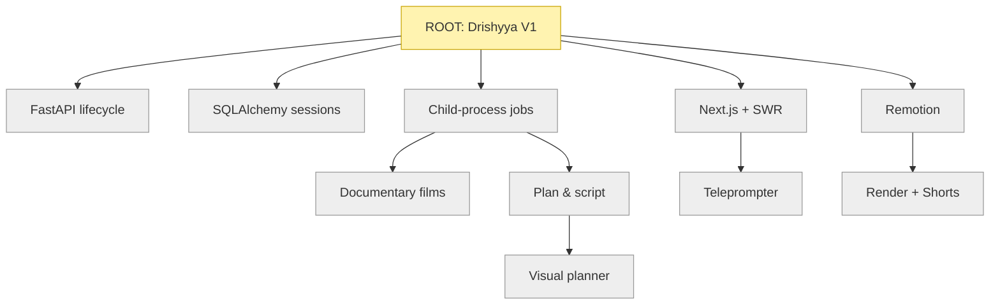

# KNOWLEDGE TREE: what Raushan understands

Statuses: [introduced] taught once · [practicing] used with help · [understood] explains alone · [mastered] can teach it
and predict failures. **Only Raushan changes a status.** Claude may only suggest a change (in /wrap) with evidence.
Everything starts at [introduced] or below; "not yet" = not taught.

## ROOT
- What Drishyya V1 is: plan → script → teleprompter record (or upload) → visuals → render, for Indian creators. [introduced] · PRD v0.2 written 2026-10-21
- Capacity maths for the MVP (videos/day, render minutes, storage, cost per video). [not yet]

## TRUNK: framework and foundations
- HTTP + REST basics: methods, status codes (409 for "already running"), idempotency of POST vs PUT. [not yet]
- FastAPI request lifecycle: Uvicorn (ASGI server) → Starlette routing → handler → response; sync `def` handlers run in a threadpool. [not yet]
- Pydantic models for request bodies (`FilmConfig`) and pydantic-settings for config from `.env`. [not yet]
- Dependency injection in FastAPI (`Depends`), and why this codebase uses a `session_scope()` context manager instead. [not yet]
- Async vs sync in Python web servers: what blocks the event loop, what a threadpool solves and costs. [not yet]
- SQLAlchemy 2.0 (sync): engine, connection pool (size 10 + 20 overflow), Session, commit/rollback, `expire_on_commit`. [not yet]
- JSON columns in Postgres and `flag_modified` (why in-place edits are not saved). [not yet]
- Schema migrations: `create_all` vs Alembic, and why `create_all` never alters an existing table. [not yet]
- Running long jobs: child processes (`subprocess.Popen`, `start_new_session`, process groups, SIGTERM), PIDs and PID reuse. [not yet]
- Job queues (Celery / RQ / Arq / a Postgres-backed queue) vs bare processes: delivery, retries, visibility. [not yet]
- File-based state and atomic writes (write to temp, then `os.replace`), and read-modify-write races. [not yet]
- CORS and why a browser blocks a cross-origin call; static file serving and what it exposes. [not yet]
- Timeouts, retries, backoff with jitter, and the danger of retrying forever. [not yet]
- Next.js app router: pages, layouts, client vs server components, build-time env (`NEXT_PUBLIC_*`). [not yet]
- SWR: cache, revalidation, polling with `refreshInterval`, error handling. [not yet]
- Remotion: compositions, frames/fps, `renderMedia`, why renders are CPU/GPU heavy. [not yet]
- Deployment: Vercel (frontend), where the API and the job workers would run, HTTPS and mixed content. [not yet]
- Auth basics: sessions vs tokens, phone OTP, protecting destructive endpoints. [not yet]

## BRANCHES
- Documentary films (studio): stages, caching/resume, live tracker. [not yet]
- Plan & script (planned): outline from topic + notes, script with visual tags, grounding. [not yet]
- Teleprompter recording (planned): browser MediaRecorder, resumable uploads, script alignment. [not yet]
- Transcribe + clean cut: Whisper word timestamps, silence detection. [not yet]
- Visual planner + storyboard: sentence → template, pacing rules, human review gate. [not yet]
- Render + Shorts: Remotion pipeline, 9:16 reframing. [not yet]
- Payments (planned): UPI via Razorpay/Cashfree, webhooks, idempotency keys. [not yet]

## LEAVES
(added as leaves are built: one line per concept a specific leaf introduced)

