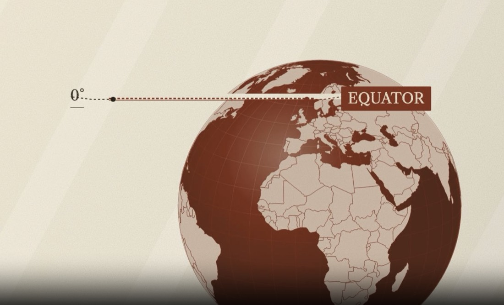
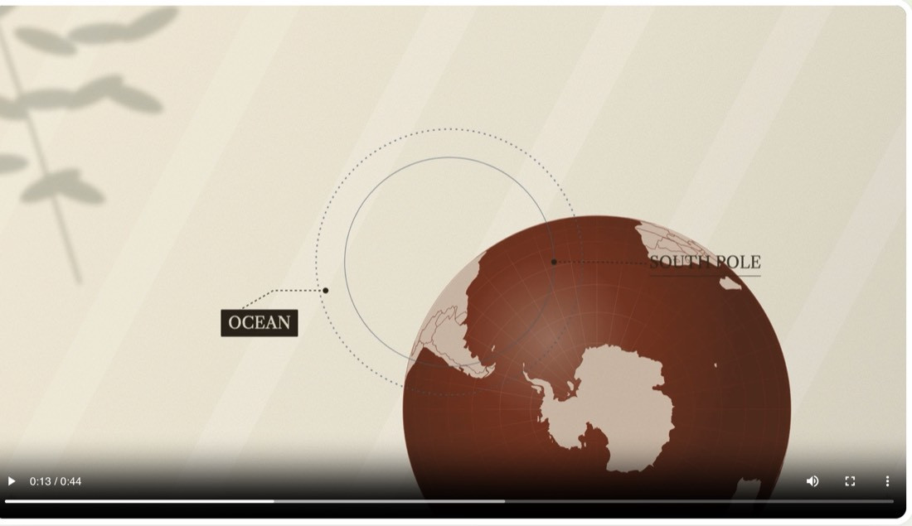
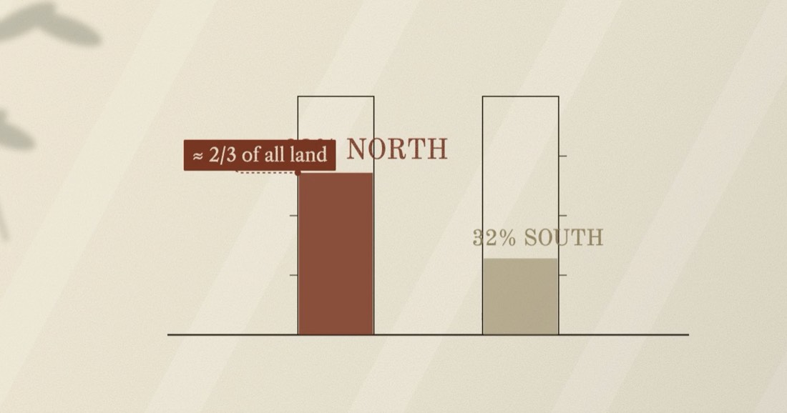

# Labels that land where they point

*Drishyya · film engine · design note · 27 October 2026*
*About the one-shot pipeline (`video/oneshot.py`), the print kit and the motion library.*

This note covers why every second film has text on top of text and arrows pointing at nothing. It also covers what the published work on AI-made video says about it, and the harness that stops it before a frame is rendered.

---

## What goes wrong

The three frames below come from one film, *Why almost 90% of humanity lives north of the equator*. Each picture is good, but each scene still fails, because the words do not sit where they mean.

| | | |
|---|---|---|
|  |  |  |
| **The equator line is in the wrong place.** It runs across Europe, about 2,000 km north of the equator. | **The pointers miss.** SOUTH POLE points at the ocean, and the "ocean" ring floats off the globe. | **Text on text.** The "≈ 2/3 of all land" tag hides "68% NORTH". |

## Why it happens

I read the code the model wrote for these scenes (`src/oneshot/gen/why-almost-90-of-humanity-lives-north-of-1027092130/film.tsx`). The three bugs have one cause: **the model typed pixel numbers for things it cannot see.**

- **Equator.**
  - The globe is placed with `<At x={960} y={540}>`. `At` puts a piece's *top-left corner* at that point.
  - The model drew the equator line at `y={542}`, as if 960,540 were the globe's *centre*.
  - The globe is also tilted 15° and zooms in, so even its centre is not where the equator is.
  - Only the globe's own projection knows that point, and the model never sees the projection.
- **South pole.**
  - This is the same corner-or-centre mix-up.
  - The target points were picked by eye: `tx={1180} ty={540}`.
  - The ring is a separate SVG at `left: 650, top: 230`, guessed in the same way.
- **Overlap.**
  - "68% NORTH" is a `Type` at `left: 690`. The tag is a `Tag` at `x={510} y={400}`.
  - Each one was placed alone. Nothing in the kit knows the other exists, so nothing can keep them apart.
- **Our check.**
  - The frame check did run on this film. It found 9 problems, mostly "the scene is too small", and rewrote those scenes whole (364 s of fixing).
  - It did not catch these overlaps. A vision model looking at a quarter-size still is a weak judge of two boxes touching.
  - Every rewrite is also a fresh chance to guess new numbers.

Patching after the render will always lag behind, because the model can make a new guess faster than we can catch the old one. The fix has to take the guessing away.

## What others found

### Code2Video: educational videos written as Manim code
*NUS Show Lab · NeurIPS 2025 (DL4C workshop)* · <https://arxiv.org/html/2510.01174v1>

This is the closest project to ours.
- **Anchor grid.** The canvas is split into a **6×6 grid of named anchor points**. The model says which anchor, or which region of anchors, an element takes, and code turns that into coordinates.
- **Critic.** It renders each section and keeps a table of which element holds which anchors. It moves crowded elements to free anchors.
- **Repairs.** They widen step by step: first the broken line, then its block, then the whole section.

Their ablation results:

| Variant | Aesthetics | Comprehension quiz |
|---|---|---|
| Full system | 79.0 | 82.0 |
| Without visual anchors | 69.2 (−9.8) | 55.2 (−26.8) |
| Without the critic | 72.5 (−6.5) | 60.7 (−21.3) |

Two more findings:
- An 8×8 grid did worse than 6×6, because more slots gave the model more room to crowd.
- The step-by-step repair used about 1.6× fewer tokens than blind retries.

### TheoremExplainAgent: long Manim explainers by a planner and a coder agent
*ACL 2025* · <https://arxiv.org/abs/2502.19400>

After 240 theorems, the authors report that "most of the videos produced exhibit minor issues with visual element layout." Strong models writing animation code hit the same wall we do.

### AutoLayout and "LLMs as layout designers"
*2025 layout research* · <https://arxiv.org/pdf/2507.04293> · <https://arxiv.org/html/2509.16891v1>

Language and vision models "falter when handling fine-grained spatial constraints, especially in tasks demanding precise coordinate positioning," and they produce "spatial hallucinations." The approaches that work let the model state *relations* (left of, above, inside). An optimiser and a checker then turn those relations into coordinates.

### Flint: a chart language for the AI era
*Microsoft Research · 2026* · <https://github.com/microsoft/flint-chart>

The model describes what the chart *means*. A deterministic compiler makes every low-level choice: scales, padding and label formats. In their words, "the model's job ends when it has described what the chart means, not how to render it."

### Automatic label placement
*Cartography · decades of practice* · <https://github.com/tinker10/D3-Labeler> · <https://arxiv.org/pdf/1912.07105>

Map makers solved overlapping labels long before AI:
1. Give each label a few candidate spots around its point.
2. Score overlaps and leader-line crossings.
3. Keep the best spot, either greedily or with simulated annealing as in D3-Labeler.

This runs in milliseconds for a scene's handful of labels, and it gives the same answer every frame.

### Evaluator–optimiser loops need clear criteria
*Anthropic · Building effective agents* · <https://simonwillison.net/2024/Dec/20/building-effective-agents>

A writer-plus-checker loop pays off when the check is clear and its feedback demonstrably improves the next try. "These two boxes overlap by 40 px" is a clear check. "Does this frame look cluttered?" is not.

## The rule

> **The model decides what and which. Code decides where.**

Never ask the model for a number it cannot see.

The model may:
- name a thing ("the equator on this globe", "the top of the North bar")
- choose a region of the frame ("the right half")
- write the words

The kit computes every pixel that depends on another piece's geometry, or on where other text already is.

```
TODAY
  model writes x={1260} y={510}  →  render film  →  vision check on small stills  →  rewrite scene, new guesses

PROPOSED
  model writes to="globe.equator", side="right"
     →  kit: anchors from each piece's own projection
     →  kit: label solver (no text on text, no crossing lines)
     →  measure boxes, then render (no model call)
```

## The harness, layer by layer

The layers are ordered by how much of the problem each one removes. The first three take the guessing away. The last three cheaply catch what is left.

### 1. Anchors on every piece
Each library piece publishes named points, computed from its own geometry on every frame:
- the globe gives `equator`, `pole.n`, `pole.s` and `at(lat, lon)`, from its real projection
- a bar chart gives `bar.North.top`
- a pie gives `slice.2.edge`
- a creature gives `head`

`RealMap.toScreen` already works this way. This layer extends it to everything a label can point at.

```tsx
<Globe id="globe" lon={10} lat={15} size={620} />
<Callout to="globe.equator" text="EQUATOR" />          // no x, no y
```
**Fixes:** the equator line and the south-pole pointer.

### 2. A label solver for every scene
Every piece of text in a scene (callouts, tags, headlines, numbers) registers its box with the scene. Before a label is drawn, the solver tries a handful of spots around its target. It keeps the first spot that is clear of:
- other text
- the frame's safe margin
- other leader lines

This is how map labels are placed. The model may suggest a side, but it never gives coordinates.

**Fixes:** "≈ 2/3" covering "68% NORTH", and every later case of the same kind.

### 3. Regions instead of pixels
- Pieces are placed by region, not pixel: a 6×6 grid of named cells like Code2Video's, plus words such as `left-half` and `center`.
- `At` gets an explicit `anchor="center"`, so a corner is never mistaken for a centre again.
- Any pixel numbers that remain in a scene are flagged before it compiles.

**Fixes:** the corner-or-centre mix-up behind the first two bugs.

### 4. Measure, don't look
We already render one settled frame per scene for the frame check. In the same Chrome pass, read the real box of every text element and every leader line. Each of these becomes a measured fact, found in seconds without a model call:
- overlapping text
- text cut off by the frame
- a leader line that ends more than 12 px from its anchor

The vision model keeps only the questions it alone can answer, such as "is this the right picture for the line?"

### 5. Small repairs with numbers in them
When a measurement fails, the writer gets the failing element's lines and the measured boxes, for example "the tag at 510,400 to 760,450 covers the text at 690,330 to 1010,400". It does not get "rewrite scene 3".

Repairs widen only when needed: first the line, then the block, then the scene. This is Code2Video's step-by-step repair, and it is cheaper than our whole-scene rewrites.

### 6. A storyboard of relations
The storyboard already lists each scene's words. It should also list what each word points at and where it sits:
- `EQUATOR → globe.equator, right`
- `≈ 2/3 → bar.North, left`

The writer turns these relations into anchor names. The plan and the code then mean the same thing, and the check can test each relation directly.

## Plan and how we will know

| Step | Work | Effort |
|---|---|---|
| 1 | `Callout` with `to=` and the scene label solver; a `Tag` without a target becomes a solver-placed label | 1 day |
| 2 | Anchors on the pieces films use most: Globe, RealMap, bars, Pie3D, HeatTiles, CubeGrid, Card, creatures | 1 day |
| 3 | Measured geometry check in the existing frame pass, as a gate before the render | ½ day |
| 4 | `At anchor`, region placement, and a lint for raw pixel numbers in labels | ½ day |
| 5 | Writer prompt: name anchors and regions, never coordinates; the storyboard gets relations | ½ day |
| 6 | Step-by-step repair fed with measured boxes, replacing whole-scene rewrites for geometry problems | ½ day |

**The measure.** Run the same 10 geography films before and after. For each film, the measured check counts three things:
- text-on-text overlaps
- labels whose leader line misses its anchor
- text cut off by the frame

The first run sets today's baseline. The target is zero of each, with fewer model calls per film than now, because fewer scenes go back for rewriting.

## What this does not fix

- **A wrong idea for a scene.** Whether the right picture was chosen is still a question for the storyboard and the viewer test.
- **Pieces with no anchors yet.** Until a piece publishes its anchors, a label can only attach to the piece's box. Step 2 should therefore cover the most-used pieces first.
- **Wrong facts.** A label in the right place can still say the wrong number. The fact check stays as it is.

---

## Sources

- Code2Video: A Code-centric Paradigm for Educational Video Generation — <https://arxiv.org/html/2510.01174v1>
- TheoremExplainAgent (ACL 2025) — <https://arxiv.org/abs/2502.19400>
- AutoLayout: Closed-Loop Layout Synthesis via Slow-Fast Collaborative Reasoning — <https://arxiv.org/pdf/2507.04293>
- LLMs as Layout Designers: a spatial reasoning perspective — <https://arxiv.org/html/2509.16891v1>
- Flint, Microsoft Research — <https://github.com/microsoft/flint-chart> · explainer: <https://betterstack.com/community/guides/ai/flint-microsoft.md>
- D3-Labeler (simulated-annealing label placement) — <https://github.com/tinker10/D3-Labeler>
- Semantic-Aware Label Placement for Augmented Reality in Street View — <https://arxiv.org/pdf/1912.07105>
- Building effective agents (Anthropic), notes by Simon Willison — <https://simonwillison.net/2024/Dec/20/building-effective-agents>

The diagnosis comes from reading the film's generated code and its run log.
