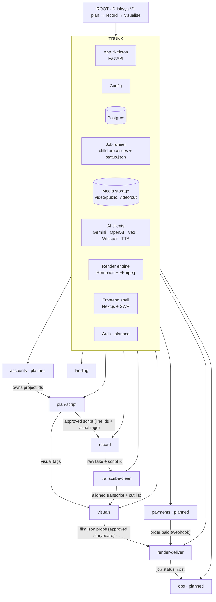

# Drishyya: High-Level Design (SYSTEM TREE)

> DRAFT — not verified by owner. Reconstructed on 2026-10-22 from the code (three read-only surveys) and from
> PRD v0.2 (`~/personal/drishya-prd/Drishyya_PRD.html`). "unknown" means the code does not say. Anything marked
> **planned** does not exist in code yet.

---

## ROOT

### Purpose
Drishyya is an AI video studio for India's Hindi and Hinglish creators. A creator brings **a topic, their notes and their
tone**; Drishyya plans the video, writes the script, shows it as a teleprompter while the creator records (or the creator
uploads footage they already have), then adds a visual for every line, edits, captions, renders and cuts Shorts.
Line: *Your idea, your voice, our visuals.*

### Users
- **Creator (primary):** education and explainer YouTubers, 10k–150k subscribers, Hindi/Hinglish, phone or webcam.
- **Operator (us):** watches the job queue, cost per job, failures; fixes jobs by hand in V1.
- Later: coaching institutes (team seats), V3.

### MVP scope (V1 = "Plan, record, visualise")
In: sign-up, plan from topic + notes, script with visual tags, teleprompter recording in the browser **or** upload,
transcription aligned to the script, clean cut, visual plan, storyboard review, 16:9 render with captions, 2–3 Shorts,
UPI payment per video, operator dashboard.
Out (V2/V3): topic radar, AI avatars, dubbing, thumbnails, analytics, team accounts, mobile app.

### What exists today
This repo is the **Video Studio**: a single-user lab that already runs most of the hard parts as separate pipelines
(documentary films, notes films, audio films, crew films, Veo cinema, slide skills). V1 is built by turning the right
pieces of those pipelines into the V1 branches below, on a hardened trunk. The marketing landing page is built
(`frontend/app/page.tsx`) and mirrored to `github.com/Raushan0303/drishya-frontend` for Vercel.

### Capacity targets (estimates; owner to re-derive in `/design-review root`)
Inputs from the PRD: Gate 1 = 30 paying creators, ≥ 40 paid videos/week; a video is ~10 minutes; turnaround ≤ 2 h;
unit cost ≤ ₹40.

| Quantity | Maths | Result |
|---|---|---|
| Videos per day (Gate 1) | 40/week ÷ 7, then ×1.5 headroom | **≈ 9/day** |
| Peak concurrent jobs | creators record in the evening: assume 60% of a day's jobs land in a 3 h window; each job is busy ~1 h (plan + visuals + render) → 9 × 0.6 ÷ 3 h × 1 h | **≈ 2 at once** (design for 4) |
| Frames to render per video | 10 min × 60 s × 30 fps | **18,000 frames** |
| Render time per video | 18,000 frames ÷ (unknown fps throughput; Remotion at concurrency 6 on one machine, assume 20–40 frames/s) | **≈ 8–15 min** (measure) |
| Raw upload size | phone 1080p ≈ 100–200 MB/min × 10 min | **≈ 1–2 GB** |
| Stored per video | raw 1.5 GB + assets 0.5 GB + master 0.3 GB + 3 Shorts 0.15 GB | **≈ 2.5 GB** |
| Storage at 30-day retention | 9/day × 30 × 2.5 GB | **≈ 0.7 TB** |
| LLM tokens per video | plan + script + visual plan + checks, assume ~150k in / 40k out | cost **unknown** (measure against ₹40) |

**Biggest consequences:** render time and storage, not API traffic, size the system. A single beefy render machine
covers Gate 1 if jobs are queued (not all started at once).

---

## TRUNK

| Component | Responsibility | Technology (today) | Status | LLD |
|---|---|---|---|---|
| App skeleton | HTTP API, routing, CORS, static media, health | FastAPI (sync handlers), Uvicorn, `backend/app/main.py` | built | [lld/trunk/app-skeleton.md](lld/trunk/app-skeleton.md) |
| Config | settings and secrets from `backend/.env` | pydantic-settings, `config.py` | built | [lld/trunk/config.md](lld/trunk/config.md) |
| Database | films, skills, settings rows | Postgres 17 (docker :5442), SQLAlchemy 2.0 sync, `create_all` (no migrations) | built, fragile | [lld/trunk/database.md](lld/trunk/database.md) |
| Job runner | start, watch, stop, resume long pipelines | detached child processes (`subprocess.Popen`), PID in `films.pid`, `status.json` files | built, fragile | [lld/trunk/job-runner.md](lld/trunk/job-runner.md) |
| Media storage | every intermediate and final asset | local folders `video/public/<slug>/`, `video/out/`, served statically | built, unprotected | [lld/trunk/media-storage.md](lld/trunk/media-storage.md) |
| AI clients | LLM text/structured/vision, images, TTS, video, transcription | Gemini (default), OpenAI, Veo, faster-whisper, ComfyUI; `llm.py`, `pipeline.py`, `comfy.py` | built, unbounded retries | [lld/trunk/ai-clients.md](lld/trunk/ai-clients.md) |
| Render engine | turn film props into mp4 | Remotion 4 (CLI + `renderMedia`), FFmpeg | built | [lld/trunk/render-engine.md](lld/trunk/render-engine.md) |
| Frontend shell | pages, API client, polling, toasts | Next.js 16 app router, SWR, `lib/api.ts`, `components/providers.tsx` | built | [lld/trunk/frontend-shell.md](lld/trunk/frontend-shell.md) |
| Auth & accounts | who is calling; whose films | **none** | **planned** | [lld/trunk/auth.md](lld/trunk/auth.md) |
| Deploy | where each part runs | local Mac (+ a Windows GPU box assumed by `gpulock.py`); landing on Vercel | partial | [lld/trunk/deploy.md](lld/trunk/deploy.md) |

---

## BRANCHES

Two groups. **V1 branches** are the product. **Studio-lab branches** exist today and are the parts V1 is built from.

### V1 branches (the product)

| Branch | Responsibility | Data it owns | Built from | Status |
|---|---|---|---|---|
| **accounts** | sign-up (phone OTP), creator profile, ownership of projects | users, projects | nothing | planned |
| **plan-script** | topic + notes + tone → researched outline → script with visual tags; creator approves | plan.json, script, sources | `doc.py` `_plan`/`write_act`, `linkread.py`, `crew/planner.py` | partly built |
| **record** | teleprompter recording in the browser (camera / audio / screen) **or** upload; resumable | raw takes | upload exists in `api/audio.py`; teleprompter none | partly built |
| **transcribe-clean** | word timestamps, align to script, remove silences/fillers/retakes | transcript, cut list | `audiofilm._transcribe` (faster-whisper) | partly built (no clean cut) |
| **visuals** | sentence → template/visual plan, pacing rules, storyboard review gate | visual plan, storyboard state | `audiofilm.plan`, `doc_layouts`, `notes` visual programs, gates in crew/audio | partly built |
| **render-deliver** | 16:9 master + captions + 2–3 Shorts, downloads | renders | `doc.render`, `notes-render.mjs`, `fastrender.py` | partly built (no captions, no 9:16) |
| **payments** | UPI per video, packs, invoices | orders, payments | nothing | planned |
| **ops** | job queue view, failures, cost per job, manual override | (reads others) | `cost.py`, `/api/jobs` stub | planned |
| **landing** | marketing site | none | `frontend/app/page.tsx`, `components/landing/` | built |

### Studio-lab branches (exist today)

| Branch | What it does | Entry points | Spawns |
|---|---|---|---|
| documentary | topic → researched, illustrated, voiced documentary | `api/studio.py`, `video/doc.py`, `archivedoc.py` | `doc.py` |
| notes-films | notes/PDF → bilingual slide film with two hosts | `api/notes.py`, `video/notes.py`, `notes-render.mjs` | `notes.py` |
| audio-films | uploaded lecture → transcript → planned slides/pictures → film (**closest to V1**) | `api/audio.py`, `video/audiofilm.py` | `audiofilm.py` |
| crew-films | LangGraph six-agent notes film with 8 human gates | `api/crew.py`, `video/crew/` | `crew/run.py` |
| cinema | short Veo films (story → frames → shots → voice → film) | `api/cinema.py`, `video/cinema.py` | `cinema.py` steps |
| slide-skills | reusable slide "looks", demo films, picture rules | `api/slideskills.py`, `api/skills.py`, `api/picturerules.py` | `slideskill.py` |

### Interfaces between branches (the contracts that must never break)

| From → To | Interface | Contract |
|---|---|---|
| any API branch → job runner | `subprocess.Popen(video/<script>.py --out <slug> --config public/<slug>/config.json)` | CLI args stable; the child writes `public/<slug>/status.json` |
| pipelines → API/frontend | `status.json` = `{stage, stages{stage:{done,total}}, log[{at,msg}], video, title…}` | `stage` values and `stages` shape; written atomically (doc.py does; others **unknown**) |
| pipelines → frontend | media at `/studio-assets/<slug>/…` and `/studio-out/<file>.mp4` | file names inside a film folder are stable |
| record → transcribe-clean (planned) | raw take file + script id | the transcript aligns to the approved script's line ids |
| plan-script → visuals (planned) | script lines with visual tags (`[FLOWCHART]`, `[MAP]`…) | every line has a stable id; tags come from the template registry |
| visuals → render-deliver | `film.json` props for a Remotion composition | props shape per composition (`Doc`, `Notes`) |
| payments → render-deliver (planned) | order paid ⇒ release downloads / remove watermark | a render is never released twice for one payment; webhook idempotent |
| frontend → API | REST under `/api`, polled with SWR (2.5–15 s) | JSON shapes; `409` = already running |

---

## Failure modes at a glance (details in RISKS.md and each LLD)
- A pipeline child dies → its film shows "stopped"; nothing resumes automatically; the user presses Continue.
- An AI call hangs or 429s → Gemini retries **forever**; the job looks alive but makes no progress.
- A crash mid-write → a truncated JSON file is treated as "done" by the cache; the film is silently wrong.
- Two clicks on Create → two films, two processes, double cost.
- Deployed as-is → anyone can call every endpoint and read every upload and log under `/studio-assets`.

## Decisions
See `docs/decisions/` (0001–0010). Studio-era choices are marked RECONSTRUCTED until the owner confirms them.
