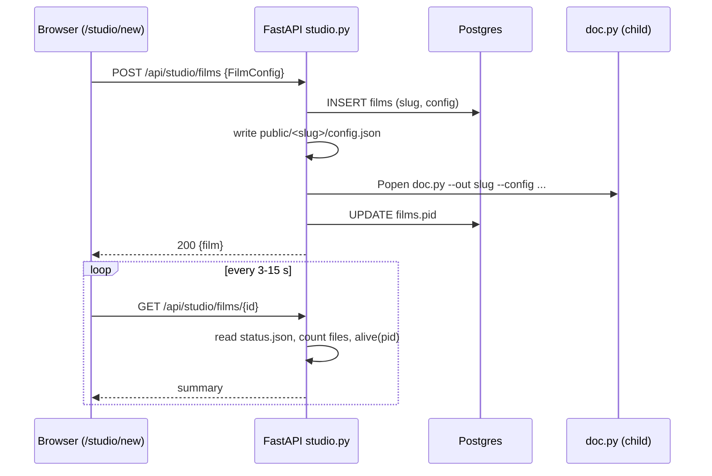

# LEAF · documentary / create-film

> DRAFT — not verified by owner · Status: built

## Files and functions
- `backend/app/api/studio.py:246` `FilmConfig`: request body (topic, minutes clamped 3–45, format, voices, links …).
- `studio.py:284` `POST /api/studio/films`: validates, inserts a `Film` (`:195`), writes `config.json`, spawns.
- `studio.py:82-97` `_spawn`: `Popen([python, -u, video/doc.py, --out, slug, --config, public/<slug>/config.json, ...])`,
  stdout → `pipeline.log`, `start_new_session=True`, `caffeinate -w pid`, `Film.pid = pid`.
- `backend/app/db.py:16-26` `session_scope()`.

## Data model
`films` row: `slug` (unique), `kind="studio"`, `config` JSON, `minutes`, `format`, `premise`, `voices`, `pid`.
Files: `video/public/<slug>/config.json` (written with `json.dump(open(...))`, handle left open, `studio.py:88`),
`pipeline.log`, then everything doc.py writes.

## Walkthrough

## Concurrency and idempotency
Not idempotent: two POSTs create two films and two processes (two charges of AI cost). Slug uniqueness is the only
guard (unknown how the slug is derived; if from the topic, a duplicate may raise on the unique index).

## Errors and timeouts
No timeout on the child. If Popen fails, behaviour unknown (no try/except seen). Errors inside the child go to
`pipeline.log` and `status.json` `failed`.

## Tests that prove it
None. First tests to write: create returns a row and a pid (spawn mocked); a second identical request is rejected
(after an idempotency fix).
